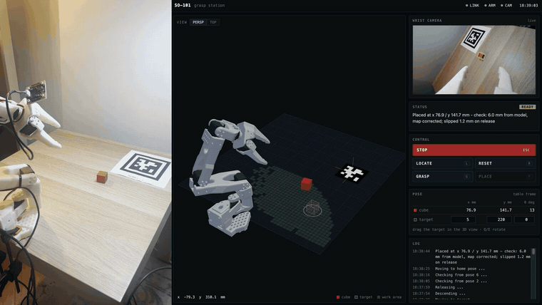
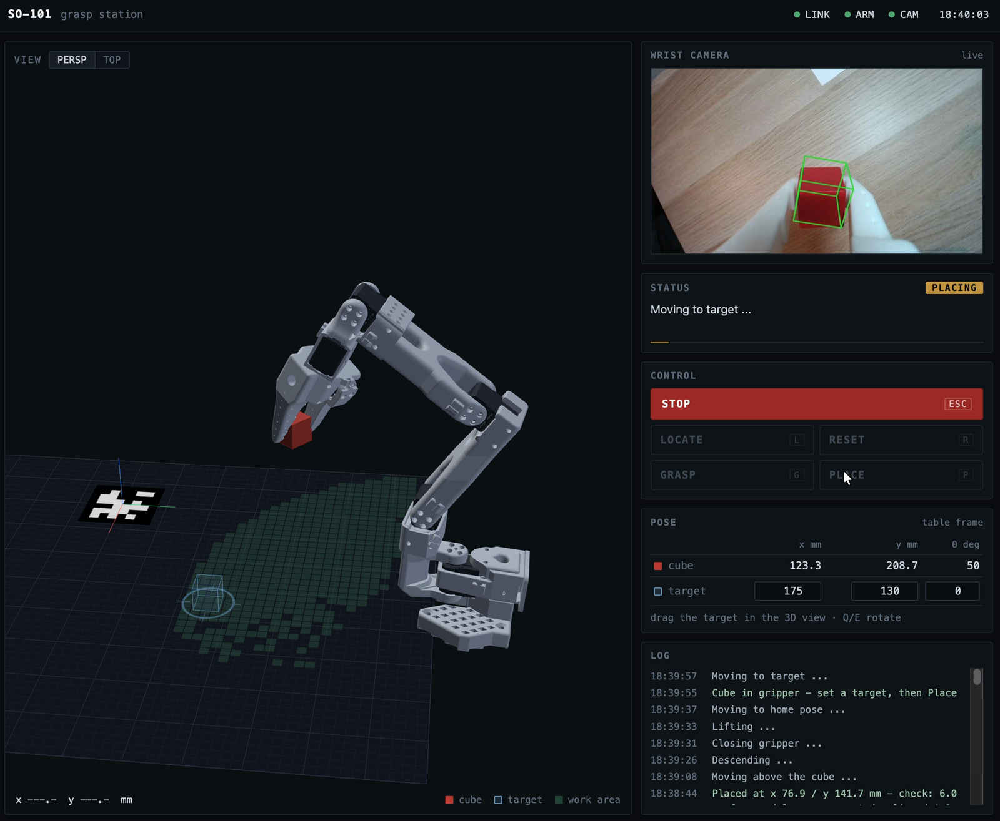

# SO-101 Grasp Station

Vision-guided pick and place with a low-cost SO-101 arm and a single wrist camera. The arm finds a 25 mm cube
on the table, picks it up and sets it down at a pose chosen in a browser UI. There is no depth sensor and no
learned policy: everything comes from calibrated geometry.



Full run, 2x speed: [docs/demo.mp4](docs/demo.mp4)

## How it works

All poses are expressed in one table frame, defined by an 80 mm AprilTag lying on the table.

1. **Locate.** The arm visits up to 10 observation poses. At each one the camera sees both the tag and the cube.
   The cube is segmented by colour and its silhouette is fitted (x, y, yaw) jointly over all views. The result
   is rejected if the fit residual exceeds 4 px or one view disagrees with the others by more than 5 mm.
2. **Grasp.** Inverse kinematics (least squares on the URDF chain) gives a hover pose and a grasp pose with the
   tool tilted at most 12° from vertical. Every path is checked for table clearance of the wrist and gripper
   links. When the gripper closes, it pushes the cube against the fixed jaw. That puts the cube at a known spot
   in the tool frame, so from then on its position follows from the joint angles alone.
3. **Place.** The arm moves so that the held cube lands on the target pose, then releases it and lifts off. It
   then checks the result from two camera poses and corrects the map if the cube is more than 3 mm from where
   the model expects it.

Before each grasp, a single-image check refuses to grasp if the cube was moved by hand since the last locate.
STOP halts the arm in place at any point.

### Calibration

| Part | Method | Result |
| --- | --- | --- |
| Camera intrinsics | Checkerboard, 1280×720 | `calibration/camera_intrinsics.json` |
| Hand-eye + joint zero offsets | Tag observations from many poses plus touching known points with the jaw tip | Tip error 4.8 mm RMS on fresh touches |
| Camera chain (for the image overlays only) | Separate camera-only fit | about 2 mm on held-out poses |
| Grasp bias | Measures how far the cube travels in the image while the jaws close | 3.5 → 2.4 mm RMS over 23 grasps |

The arm is repeatable to about 0.7 mm, so positions it produced itself stay consistent even where the absolute
calibration is off by a few millimetres.

### Current accuracy

On the recorded images, locate fits each view to 1–3 px. Placement is the weak spot. In the recorded run the cube landed about 19 mm
from the target, while the post-place check put it 8.6 mm from where the model expected it. The likely cause is
the model of where the cube sits in the gripper after closing. This is the next thing to fix.

## UI



The UI is plain HTML and three.js with no framework. It shows the live arm pose and the work area (cells that
are both reachable and visible from the observation poses). The wrist camera image carries two overlays: the
detected cube outline and the model cube projected into the image. Drag the target in the 3D view and rotate it
with Q/E. Keys: L locate, G grasp, P place, R reset, Esc stop.

The browser only sends commands. A small loopback server accepts a whitelist of them and writes
`ui/data/command.json`. The Python station polls that file, owns the serial bus and the camera, and publishes
its state as JSON in the same folder.

## Layout

```
station/        Python: station loop, planning, vision, hardware I/O
  grasp_app.py      main loop: commands, locate / grasp / place, state for the UI
  grasp_plan.py     grasp geometry, IK, table-clearance checks
  grasp_area.py     observation poses and the reachable + visible work area
  grasp_measure.py  grasp bias from the push of the closing jaws
  cube_detect.py    red cube segmentation
  cube_fit.py       multi-view silhouette fit of the cube pose
  camera_chain.py   camera-only calibration used for the image overlays
  robot_model.py    calibrated kinematic model (URDF + offsets + hand-eye)
  so101_kinematics.py  URDF forward kinematics
  arm_io.py         follower bus, interpolated moves with following-error abort, tag detection
  live_robot_view.py   joint stream for the UI
ui/             browser UI and the loopback command server
config/         model config, cube colour settings, fitted camera chain and grasp bias
calibration/    intrinsics, hand-eye, table registration, motor calibration (specific to this arm)
models/so101/   URDF
data/           reference observations used by the tests and the work-area search
tests/          offline tests with recorded images, no hardware needed
```

## Running

You need an SO-101 follower arm, a wrist camera, the AprilTag (tag36h11, id 1, 80 mm) on the table and a red 25 mm
cube. The files in `calibration/` belong to my arm and camera. A different setup has to be calibrated first.

```sh
pip install -r requirements.txt
cd ui && npm install && cd ..

python station/grasp_app.py        # owns the arm and camera; SO101_PORT=/dev/... to override the serial port
node ui/server.mjs                 # http://127.0.0.1:4173
```

On exit the arm keeps holding its pose. To switch torque off, hold the arm and run
`python station/arm_io.py --release`.

## Tests

```sh
python -m unittest discover -s tests -t .   # planning, bookkeeping, grasp-bias measurement, camera chain
cd ui && npm test && npx playwright test    # scene math and browser tests with a mocked station
```

The motor bus comes from [LeRobot](https://github.com/huggingface/lerobot). The SO-101 URDF and meshes come from
[TheRobotStudio/SO-ARM100](https://github.com/TheRobotStudio/SO-ARM100) (commit `a758567`).
